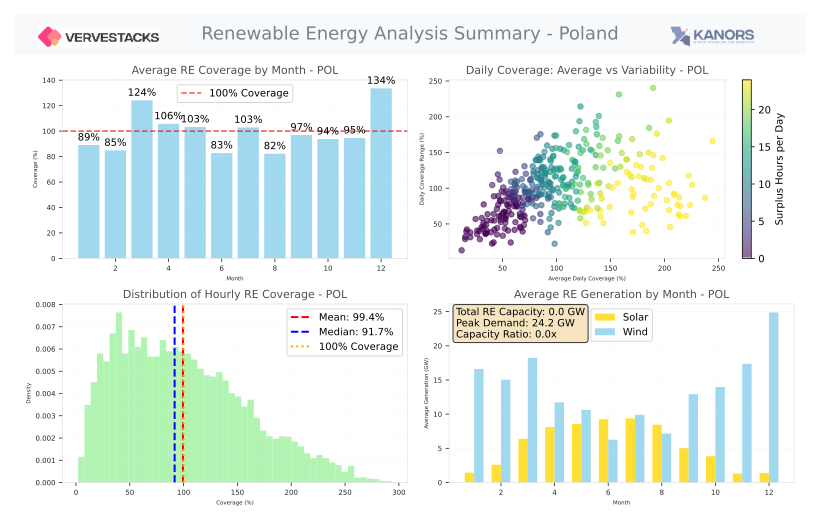
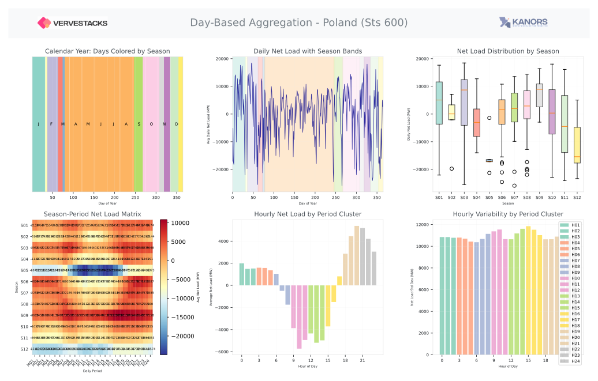
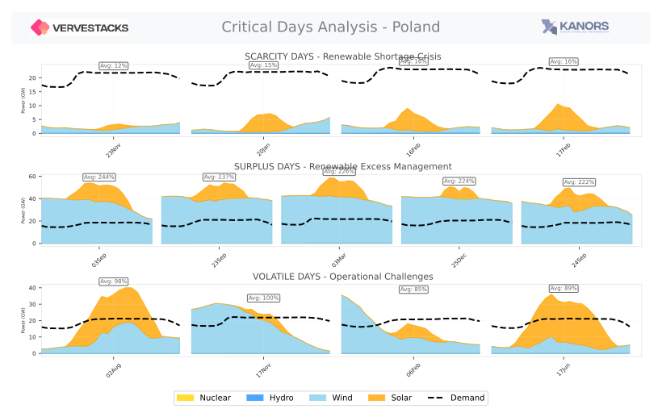

# Temporal Modelling — POL

---

This model employs sophisticated **statistical scenario generation** to identify critical periods
in high-renewable energy systems: **scarcity** (renewable shortfall days), **surplus** (generation
excess days), and **volatile** (high-variability days) — each captured as representative days to
size backup capacity, storage, and flexible resources.

*→ [Stress-based timeslice design](https://kanors-emr.github.io/VerveStacks-docs/methods/stress-timeslices/)*

---

## Renewable Energy Analysis Overview

  

---

## Aggregated days and hours (sts_600)

  

---

## Critical periods (sts_600)

  

